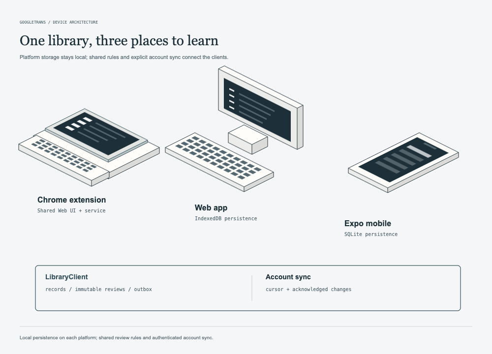

# GoogleTrans

网页阅读用词汇学习工具，包含 Chrome 扩展、Web 应用、Expo 移动端和同步服务。扩展、Web 与移动端共用 `packages/core` 和 `packages/data`；各端本地保存词库，登录后可选择导入匿名词库并同步。

## 多端词库与同步

Chrome 扩展、Web 和 Expo 移动端共用学习规则与数据客户端，通过平台存储适配器保存本地词库。保存词条会同时记录待同步变更；登录后，客户端按游标交换变化并处理服务端确认。



图中设备用来区分三种平台边界；屏幕是示意，不代表原生真机验收截图。

| 层 | 负责什么 | 实现 |
| --- | --- | --- |
| 学习与协议 | 词条身份、复习事件、变更排序、请求校验与批次大小 | [`packages/core`](packages/core/src/sync.ts) |
| 本地数据客户端 | 词库、待发送 outbox、备份、恢复与同步 | [`packages/data`](packages/data/src/client.ts) |
| 平台存储 | Web/扩展与移动端各自的持久化适配 | [`store.ts`](packages/data/src/store.ts) · [`sqlite-store.ts`](apps/mobile/src/sqlite-store.ts) |
| API | 身份校验与按用户隔离的同步入口 | [`apps/api`](apps/api/src/app.ts) |

复习记录是不可变事件，学习进度由事件重放得到。同步请求同时限制记录数与 UTF-8 字节数，避免大词库一次上传超过服务端上限。

当前图解对应 `codex/multiplatform-foundation` 分支。扩展真实安装、原生设备运行、公网部署与真实翻译提供方验收仍需分别完成，详见[多端验证记录](docs/architecture/multiplatform-verification.md)。

## 快速启动

需要 Node.js 24 和 pnpm 10.33.0。

```sh
pnpm install --frozen-lockfile
pnpm build
```

在三个终端分别运行 API、Web 和移动端开发服务：

```sh
pnpm dev:api
pnpm dev:web
pnpm dev:mobile
```

API 默认监听 `127.0.0.1:8787`，Web 开发服务器使用 Vite 地址。移动端可用 Expo Go（SDK 57）或 iOS/Android 开发构建运行；真机连接本机 API 时，将服务端 `HOST` 设为 `0.0.0.0`，客户端服务器地址设为开发电脑的局域网地址。

需要服务器翻译时，复制 `.env.example` 为根目录 `.env` 并填写 `TRANSLATION_API_URL`、`TRANSLATION_API_KEY` 和模型，API 启动时会自动读取。未配置翻译服务时仍可手工输入翻译。

## Chrome 扩展

`pnpm build` 会先构建 Web UI、再构建扩展并生成仓库根目录 `manifest.json` loader。Chrome 开发者模式选择“加载已解压的扩展程序”，选择**仓库根目录**。重建后在 `chrome://extensions/` 重载扩展。保持从相同根目录加载可以保留扩展 ID；不要改为从 `.output` 子目录加载。扩展首次启动会将旧 Chrome Storage 词库导入新本地存储，并保留旧数据。

在 API 的 `ALLOWED_ORIGINS` 中加入 `chrome-extension://你的扩展ID`，重启 API 后即可从扩展登录和同步。ID 可在扩展管理页查看。

## 检查与架构

```sh
pnpm run check:all
```

架构状态与各环境验收边界见[架构文档入口](docs/architecture/README.md)和[多端验证记录](docs/architecture/multiplatform-verification.md)。API 和单实例 Docker 部署说明见 [`apps/api/README.md`](apps/api/README.md) 与 [`deploy/README.md`](deploy/README.md)。
