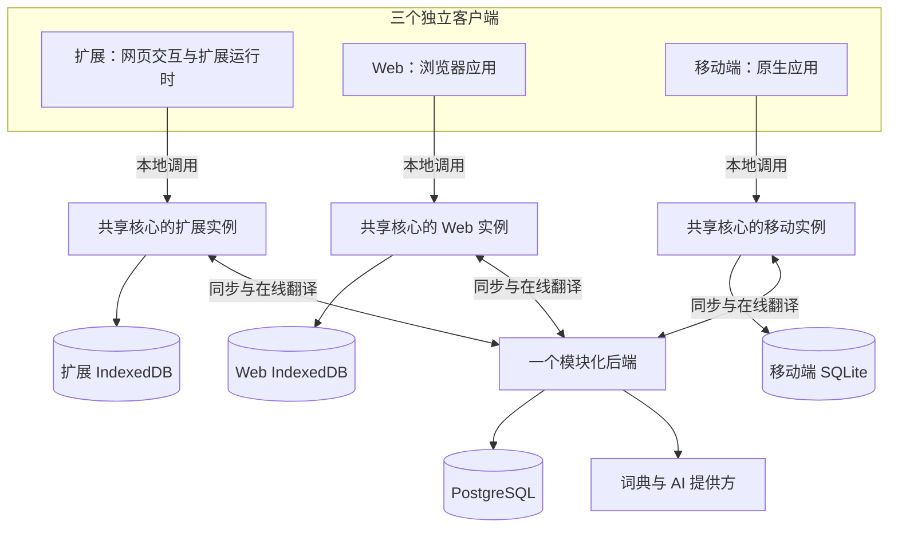

# 多端学习产品：架构重建设计提案

日期：2026-10-03  
状态：历史目标架构提案与重构前审计快照；当前实现见下方链接  
代码基线：`a3ac6a4`  
范围：业务模型、运行时边界、存储与同步、构建与验证、迁移路径。UI 视觉设计不在本轮范围内。

用户已明确：未来同时支持浏览器扩展、Web 和移动端；允许暂时停用部分功能，集中重建核心。

本文保留重构前的源码审计和完整目标，行号及问题表对应上面的代码基线。2026-10-04 的扩展、Web、移动端和同步服务实现，以[当前实现](current-and-target.md)、[实施计划](implementation-plan.md)和[多端验证记录](multiplatform-verification.md)为准。本文的初始分期与技术选项不是当前完成状态。

## 1. 核心判断

建议以“共享业务核心 + 各端适配器 + 本地持久化 + 一个模块化后端”重建产品基础。扩展成为其中一个客户端，业务模型从浏览器 API、DOM 和页面状态中独立出来。

核心重建阶段的完整目标是一条可验证的业务路径：查词 → 保存带语境的词条 → 生成学习卡 → 提交复习 → 本地持久化。本轮先落地构建链路和共享学习调度器，数据层重建随后推进。之后用扩展与最小 Web 客户端验证同一份业务规则及断网同步，再接移动端。

所谓现代架构，在这里应落实为五项工程能力：

- 核心业务在没有浏览器、网络和数据库的环境中也能测试。
- 每份持久数据都有明确所有者、事务边界、版本和迁移办法。
- 进程退出、重复请求、网络中断和客户端版本不同都属于正常运行条件。
- 构建、依赖、协议和模块边界由工具检查，开发者能确定改动实际进入了发布包。
- 人和 AI 修改代码时，都能从同一套接口、约束和行为测试得到反馈。

成本也需要明确：多端离线能力会引入同步协议、冲突处理、数据库迁移和后端运维。下面的设计通过限定首期功能和部署数量控制这部分成本。

## 2. 当前架构的事实与影响

本次做了源码、入口和配置检查，没有安装依赖、执行测试或实际加载扩展。下列代码问题与风险分析不等于已经复现用户端故障。

静态扫描发现 `extension/` 下有 23 个含 Chrome Storage 写操作的代码文件，Popup 代码有 109 处 `window.xxx =` 形式的赋值。这些数量包含重复产物及不同用途，只作为耦合程度的线索。

| 观察 | 代码证据 | 对重构的影响 |
| --- | --- | --- |
| 运行文件和源码构建没有形成清晰闭环 | `manifest.json` 加载 `extension/content/content-bundle.js`；`package.json` 的 build 仅执行 TypeScript 编译；当前受版本控制文件中未找到扩展 bundle 构建脚本 | 无法仅凭修改某个源码文件就确认发布行为改变。需要唯一、可重复的构建入口 |
| 模块依赖依赖全局变量是否恰好存在 | `extension/background/background.js:25` 的初始化读取 `self.ModuleManager`、`self.translateWithAI` 等；当前后台入口没有实际的 import/importScripts 加载语句 | 必須用显式依赖图取代运行时猜测。模块未接入应在构建或启动验证阶段暴露 |
| TypeScript 产物路径不一致 | `tsconfig.json` 输出到 `build/dist`；`extension/services/pos-integration-service-v2.js:17` 导入 `extension/dist` 下的模块 | 构建器应直接处理源码依赖，业务源码不引用手工搬运的编译目录 |
| 多处读出完整词库后再覆盖写回 | `extension/content/content.js:2670` 保存翻译；`extension/popup/modules/data-manager.js:53` 加载并补写复杂度；抽屉及管理模块也操作词库 | 两个页面基于同一旧快照写入时可能互相覆盖。需要记录级事务和明确写入入口 |
| 业务状态与页面状态混合 | `extension/popup/modules/data-manager.js` 维护多个全局索引；`extension/popup/popup.js` 操作大量 window 状态；Dashboard 又维护自己的 Store | 词库和学习规则难以跨端复用，刷新与失效规则分散 |
| 存在两套复习时间计算 | `learning-manager.js:746` 按掌握程度使用 1/2/4/7/14/30 天；`review-queue-manager.js:339` 使用复习次数和难度计算指数间隔 | 调度规则需要唯一实现；队列只根据结果查询和排序 |
| 翻译策略散落在多个运行环境 | `content.js:1346` 自行缓存、请求和降级；`background.js:365` 再次编排 AI 与有道；`quality_service.js` 也维护并行与失败缓存 | 重试次数、总耗时、结果格式和上下文缓存容易不一致 |
| 缓存身份无法完整表达语境 | `content.js:1349` 主要用小写文本作缓存键 | 同一词在不同句子中的词性和释义可能被错误复用 |
| 工程验证中存在不能证明行为的测试 | `tests/unit/managers/review-queue-manager.test.js` 前段有多处 `assert(true)`，且在后段 Jest 测试前执行 `process.exit` | 不能把现有测试数量当作安全网；要逐个确认测试执行了真实业务实现 |
| 部分历史引用没有清理 | Popup 引用缺失的旧 `word-drawer.js/css`；文档提到的 TAROT 源码不在当前工作区；manifest 与 package 版本不同 | 需要明确当前支持的功能清单与实际运行入口，历史文档归档 |

这些问题的共同原因是：页面、数据结构和外部服务都能各自实现业务规则。文件虽然已经拆开，但权责没有收拢。

现有可保留的资产包括：真实使用流程、词库数据、词形与语法规则、API 字段转换经验，以及能证明行为的测试案例。保留代码需以新边界下的适配和测试为条件。

## 3. 目标结构与职责

下面的“共享核心”是被各应用导入的代码包，不是一个远程服务。每个客户端都运行自己的实例；各端本地数据库也彼此独立。



| 边界 | 负责 | 依赖约束 |
| --- | --- | --- |
| 领域规则 | 词条身份、语境归属、卡片、复习调度、统计定义 | 不依赖 Chrome、DOM、React、HTTP 或具体数据库 |
| 应用用例 | 保存词条、提交复习、查询待复习卡、导入数据 | 调用领域规则，通过少量明确接口访问存储、时钟和网络 |
| 平台适配 | 浏览器消息、页面选择、IndexedDB、SQLite、后台唤醒 | 实现核心所需接口，不复制业务规则 |
| API 协议 | 请求、响应、错误、同步操作的运行时 Schema 与版本 | 与数据库表和页面状态分开定义 |
| 服务端模块 | 身份验证、账号数据、同步裁决、在线翻译、用量控制 | 一个应用和数据库起步；业务模块之间使用明确接口 |
| 展示层 | 显示查询结果、收集操作、维护当前筛选等临时状态 | 调用用例或客户端接口，不直接更新持久业务状态 |

业务按功能组织为 `vocabulary`、`translation`、`learning`、`analytics`；同步和身份验证拥有独立边界。避免继续把所有领域内容堆进通用的 `services/`、`utils/`、`managers/`。

每个跨边界接口都应由真实需要驱动。例如 `ReviewRepository`、`TranslationProvider`、`Clock` 是稳定接口；为每个函数创建一组 factory/manager/service 没有必要。

## 4. 仓库与构建建议

建议保留一个仓库，采用 pnpm workspace。workspace 支持本地包依赖，适合多个应用共享业务包；先用其脚本完成任务编排，构建确实变慢后再评估额外任务缓存。[pnpm 官方说明](https://pnpm.io/workspaces)

```text
apps/
  extension/                 # WXT；网页脚本、后台、Popup 等入口
  web/                       # Web 客户端，先提供最小功能验证入口
  mobile/                    # 移动端，后续里程碑创建
  api/                       # 一个后端部署单元
    src/modules/
      identity/
      vocabulary/
      learning/
      translation/
      sync/
packages/
  core/                      # 按业务功能组织的领域规则、用例、接口
  contracts/                 # 运行时 Schema、协议类型、错误码
  data-browser/              # IndexedDB 实现及迁移
  data-mobile/               # SQLite 实现，接移动端时再创建
  sync-client/               # 与平台无关的同步状态机
docs/
  architecture/
  decisions/                 # 短篇架构决策记录
```

这是目标布局；按里程碑创建实际用到的目录，避免提前搭空壳包。

| 位置 | 建议 | 选择理由与条件 |
| --- | --- | --- |
| 共享核心 | TypeScript strict、ES Modules | 现有 TS 规则可逐步移入，多端与后端可共享；运行时输入仍需校验 |
| 扩展构建 | WXT | 统一扩展入口、资源打包和 manifest 生成，消除手工同步 bundle 的流程 |
| Web | React + Vite 作为默认候选 | 与 TS 生态和后续移动端知识体系一致；本轮不迁移视觉设计，业务层不依赖 React |
| 移动端 | Expo / React Native 作为默认候选 | 共享 TS 业务代码；平台展示和原生能力仍分别实现，需要真机验证 |
| 本地存储 | 扩展/Web 用 Dexie + IndexedDB；移动端用 SQLite | 两套平台适配器实现相同业务存储契约，保留原子事务能力 |
| 后端 | TypeScript + Fastify + PostgreSQL | 一个部署单元起步，模块边界清晰，事务负责权威数据一致性 |
| 输入与协议 | Zod Schema；HTTP 用 OpenAPI 描述 | 编译时类型和运行时校验同时存在；约定一个 Schema 源生成对外契约，避免手工维护两套字段 |
| 测试 | Vitest、保留有价值的 fast-check 性质测试、Playwright 扩展测试 | 统一新核心的测试入口；迁移期旧 Jest 可独立保留，避免同时改写全部测试 |

这些是当前的适配建议，具体依赖版本应在实施时锁定稳定版并做组合兼容验证。WXT 支持直接从源码入口打包并生成 manifest；它本身不强制更换 UI 框架。[WXT 入口文档](https://wxt.dev/guide/essentials/entrypoints)

Dexie 提供 IndexedDB 的 Schema 与事务封装，Expo 提供 SQLite 模块。两者不自动提供这三个客户端之间的同步；同步是下一节的独立责任。[Dexie 设计说明](https://dexie.org/docs/Tutorial/Design)、[Expo SQLite](https://docs.expo.dev/versions/latest/sdk/sqlite/)

后端和验证工具的能力依据：[Fastify TypeScript](https://fastify.dev/docs/latest/Reference/TypeScript/)、[Zod](https://zod.dev/)、[Vitest](https://vitest.dev/guide/)。

## 5. 先重建业务数据模型

目前用 `word.toLowerCase()` 作键，往一个对象里放翻译、次数、词性、历史和学习状态，很难支持语境、多义词和跨端合并。

建议的最小模型如下。初期可以减少物理表，但这些语义应当分开：

| 对象 | 含义 | 关键字段示例 |
| --- | --- | --- |
| VocabularyEntry | 用户收藏的学习条目，支持词、短语、句子 | id、language、originalText、normalizedText、kind、starred、note、version、deletedAt |
| Encounter | 某次在真实语境中遇到该条目 | id、entryId、sentence、targetStart/End、sourceUrl、observedAt |
| TranslationResult | 某个输入和语境下的解释结果 | id、translation、senses、tokenPOS、provider、model、schemaVersion、promptVersion |
| StudyCard | 真正被复习的单位 | id、entryId、meaning/context 引用、promptKind、status |
| ReviewEvent | 一次提交后的作答事实 | id、cardId、rating、mode、observedAt、deviceId、algorithmVersion |
| ReviewState | 从基线与复习事件计算的当前调度状态 | cardId、dueAt、schedulerState、algorithmVersion、revision |

关键约束：

- ID 在离线时也能生成，不能用可编辑文本或数组下标充当跨端身份。
- 语言、条目类别和版本化的规范化规则共同参与去重；不同语境通过 Encounter 保留。
- 同一词条可以有多张学习卡，例如识义和拼写可以有独立进度。首期只启用一种卡型即可。
- 词性属于具体 token 在某个语境中的解释；词典给出的可用词性集合另行保存。
- 原始文本、用户笔记、已保存释义属于用户数据。重新请求 AI 不应覆盖用户编辑。
- 接口不返回提供方原始 JSON 作为领域对象；平台坐标、DOM Range、CSS 类也不进入共享模型。
- 数据格式版本、同步协议版本、算法版本分别演进，不能全都绑定到扩展版本号。

例子：用户分别在 “a broken window” 和 “the window was broken by …” 里遇到 broken。两次 Encounter 保留各自的句子及目标位置，共用同一词条身份；词性解释与学习卡可以区分。当前将词性永久挂在小写单词键上的做法无法完整表达这个关系。

## 6. 本地数据所有权与同步协议

建议采用本地优先的读写体验，加上服务器裁决跨设备冲突。离线保证范围是已有词库、复习和已缓存解释；获取新的在线翻译仍需要网络或另行安装的本地模型。

扩展内部由后台承接业务写命令，Popup 与 content script 通过明确消息调用。这样可以减少写入入口，但不能把“单一后台”当作锁：同一 Service Worker 仍可能并发处理多个异步请求，最终一致性必须依靠数据库事务和唯一约束。

`chrome.storage` 保留少量平台配置和启动元数据，词条、复习、待同步操作使用记录级数据库。词条、索引、统计分层存放：索引和统计可重建，词条及作答事实不可因缓存淘汰而删除。

Web 与扩展虽然都能使用 IndexedDB，但处于不同 origin，数据库并不共享。它们依靠同步协议交换数据。

### 一次离线写入的完整流程

1. 校验用户操作，生成稳定 operationId。
2. 在同一个本地事务中，更新业务记录并插入 outbox 待同步操作。
3. 事务成功后再反馈“已保存”；本地变化立即可读。
4. 联网时发送有限批量的操作。网络超时可用同一个 operationId 重试。
5. 后端验证身份和操作 Schema，在一个事务中检查幂等键、执行业务变更、写入变化记录并保存处理结果。
6. 客户端收到确认后，在本地事务中应用服务器结果并确认 outbox 项；未确认项继续保留。
7. 按服务器游标分页拉取变化，在本地事务中应用每页变化并推进游标。

网络提供的是可重试交付，数据库中的幂等处理保证同一次提交不会重复产生业务效果。仅有请求去重 Map 无法覆盖后台退出和重启。

### 第一版必须明确的冲突规则

| 数据 | 初版策略 |
| --- | --- |
| 新增词条 | ID 幂等；同账号规范化文本冲突时合并到已有词条，并返回 ID 映射，保留 Encounter |
| 星标等简单标量 | 使用有版本的字段修改命令；初版可以接受服务器接收顺序裁决，需承认晚到的离线操作可能覆盖较早提交 |
| 用户笔记、人工修改释义 | 带 baseVersion 的条件更新；冲突保留双方版本或进入明确的冲突状态，避免静默丢失用户文本 |
| 查词和复习事实 | 使用事件 ID 去重，保留不同设备的真实事件；计数由事实和迁移基线计算 |
| 复习状态 | 客户端离线计算暂定结果；服务器按同一算法版本和确定顺序计算并下发权威状态 |
| 删除 | 使用删除标记；过时的更新不能隐式复活条目，恢复必须是显式操作 |
| 缓存、Trie、优先队列、图表结果 | 各端根据基础数据重建，不作为跨端权威数据同步 |

复习事件需要特别设计：保留设备报告的发生时间和服务器接收时间，对异常时钟进行标记；采用经校验的事件时间与稳定 ID 排序。晚到事件可能触发重新计算，所以同步后 dueAt 可以修正。服务端裁决顺序、时间校验和算法版本切换必须写成可重放的测试规范。不能分别同步三端自行覆盖的 masteryLevel。

第一版不要求每个模块都采用事件溯源。复习与查词保留事实日志，词条和设置继续使用普通实体表。

### 不能遗漏的同步边界

- operationId 按账号作用域唯一；账号身份从已验证会话取得，不能相信请求体里的 userId。
- 本地事务必须同时写业务记录与 outbox；服务器事务必须同时写业务结果与幂等回执。ACK 丢失后的重试仍返回同一结果。
- 同步游标不能简单取自设备时间或一个可能先分配、后提交的自增序列。初期可用按账号串行提交的 revision 方案保证变化提交顺序，验证后再扩展吞吐。
- 拉取远程状态时，仍未确认的本地操作不能被直接覆盖。维护服务器基线并重放待提交命令，或使用能表达同等语义的设计。
- 过期游标走完整快照恢复，保留并重新校验本地 outbox。删除标记的保留期和过期策略需匹配，避免旧设备恢复已删除条目。
- 幂等记录清理要与最大重试窗口匹配；复习 eventId 的唯一约束应长期保留，防止旧请求再次计数。
- 未知协议/数据版本暂停同步并提示升级，不能“清空后重试”；永久无效的命令进入可解释的失败状态。
- 匿名本地数据归属 localProfile；登录后通过幂等导入转移到账号。切换账号时分隔数据库命名空间与 outbox，避免串号。
- 移动端和扩展后台都不保证永久在线。前台启动、恢复网络和平台允许的后台事件触发同步，产品允许短暂延迟。

实现前先用“两个设备离线新增词条、各提交一次复习、再同时上线”的小原型验证协议。若这部分成本高于预期，应评估成熟同步方案，并用同一组崩溃、删除、重试和权限测试比较；不能假定任一同步 SDK 已适配 MV3。

数据库事务的隔离与并发行为需要以实际 PostgreSQL 配置测试，不应假定默认隔离级别会自动消除所有竞争。[PostgreSQL 事务隔离](https://www.postgresql.org/docs/current/transaction-iso.html)

## 7. 扩展的运行时边界

content script 负责选区、提取有限语境、高亮、显示结果，以及卸载时清理事件和观察器。它发送 `TranslateSelection`、`SaveEncounter` 等明确请求。翻译策略、账号凭证和词库写入放到扩展后台对应适配器。

所有运行时消息在接收端做 Schema、来源、大小和权限校验；返回统一错误码及 requestId。后台按受支持的业务操作处理请求，避免暴露可访问任意 URL 的通用代理。

Chrome 的 content script 跨域请求仍受页面 origin 的限制；有权限的扩展 Service Worker 可以执行对应跨域请求。这个边界也是统一网络入口的实际原因。[Chrome 网络请求文档](https://developer.chrome.com/docs/extensions/develop/concepts/network-requests)

Service Worker 要按可随时退出的事件处理器设计：

- 在同步执行的入口中注册消息、安装和唤醒监听；数据库初始化由共享 ready Promise 在处理请求时等待。
- 必要状态持久化；全局对象只是可丢弃的缓存。
- 用短事务保存关键结果，长请求设置明确截止时间；重启后可恢复未确认操作。
- 安装迁移可重复执行，不能依赖内存里的“已经初始化”标志。
- 网络响应使用 requestId 关联当前选区；取消或过时响应不得更新新选区的结果。
- 对 SPA 路由变化和动态 DOM 提供增量扫描、清理和容量限制，避免多次初始化叠加监听器。

Chrome 官方说明空闲通常会触发 Service Worker 终止，全局变量随之丢失。因此实际验收需要停止后台后重试操作，而不能仅在 DevTools 保持打开时测试。[Chrome 生命周期文档](https://developer.chrome.com/docs/extensions/develop/concepts/service-workers/lifecycle)

当前源码对动态加载的注释也需要纠正：扩展 Service Worker 支持静态 import（module 模式）或 importScripts；动态 import() 不受支持。重建后让构建器生成适合 MV3 的依赖产物，并检查最终包。[Chrome 模块加载文档](https://developer.chrome.com/docs/extensions/develop/concepts/service-workers/basics)

## 8. 翻译与 AI：一个业务入口，可替换提供方

为查词定义稳定输入：文本、源/目标语言、有限句子语境、目标 token 范围，以及需要的能力。定义稳定输出：基础译文、释义、音标、词性、例句、来源与质量状态。

各供应商 adapter 只做鉴权、请求和字段转换；一个 orchestration 层决定缓存、超时、重试、降级与成本预算。初期保留一个主要提供方和一个备用提供方，减少组合状态。

区分三个用途：快速翻译、词典详情、语境分析。基础翻译先返回，昂贵的解释按需要获取；用户无需等待所有增强功能完成才能保存词条。

缓存键至少包含规范化版本、语言对、文本、语境摘要、目标范围、任务类型，以及影响结果的模型/提示词/输出 Schema 版本。私人语境结果按用户隔离；限流和密钥错误不能作为“这个单词无法翻译”长时间缓存。

超时需要向真正的网络请求传递 AbortSignal，而不只是停止等待 Promise。顺序降级使用一个总时间预算；如果未来确有延迟需求再评估延迟竞速，并计入多次调用成本。现有 `quality_service.js` 的 Promise.all 会等待各请求完成，不能据其“首个成功”注释推断行为。

AI 输出先做运行时结构校验，再校验 token 范围、枚举、缺失字段等业务约束。结果注明来源；提供方错误、解析失败、无匹配和离线要有不同错误码。

面向公众的服务由后端持有产品的提供方密钥和用量控制。用户自带密钥及 Ollama 属于可选设备级能力，单独存放、按能力启用。网页内容脚本不接收提供方密钥；用户输入的任意服务地址也不能直接转化成后端任意 URL 请求。

维护固定的语境样例集评估词性与释义质量，覆盖分词、多义词、词组和边界输入。每次更换模型、提示词或降级策略，记录质量、P95 延迟和请求成本；CI 使用确定性 fixture，真实付费 API 评估独立执行。

## 9. 学习引擎与统计

只保留一个 Scheduler 接口。它接收卡片状态、复习结果、明确时间和算法配置，返回新状态与事件。浏览器 API、页面元素和数据库访问都在调用方完成。

复习队列只回答“哪些卡到期、按什么顺序展示”，不再拥有独立的下一次复习时间计算。索引和队列是可重建的查询工具。

FSRS 可作为新调度器候选，`ts-fsrs` 是现有 TypeScript 实现。选用前验证浏览器/移动端打包、评分映射和旧数据初始化；共享的是调度接口及版本化行为，参数训练可后置。[ts-fsrs 官方仓库](https://github.com/open-spaced-repetition/ts-fsrs)

重建核心与升级学习算法应有各自验收。旧数据没有足够历史时，不能推导出可靠的新算法记忆参数；保存原始进度为迁移基线，采用明确的初始化规则，不制造历史答题事件。

统计统一定义：查词次数来自查词事实与历史基线；答题次数来自 ReviewEvent；待复习数来自统一 dueAt；“打开详情”属于浏览行为，不能自动等同于完成一次复习。日统计明确使用用户时区，并保存必要的时间信息，避免跨时区后无法解释历史。

## 10. 后端与发布边界

后端先作为一个模块化应用部署，数据库优先选择托管 PostgreSQL 以减少运维。词库、学习、同步、身份、翻译是代码边界，不要求独立部署。

服务端复用共享领域规则，并对所有输入重新校验。客户端提供离线体验，服务器负责账号归属、并发合并、幂等与在线服务访问。服务端返回调度版本，旧客户端遇到不支持的版本进入明确兼容流程。

身份验证接入成熟实现；Web、扩展和移动端的登录回调、会话存储各有适配器。服务端所有查询和修改都按已验证账号限制，缓存也按数据性质决定是否允许跨用户共享。

初期部署组件限于静态 Web、API、PostgreSQL。需要长任务后再从同一代码库增加任务 worker；Redis、消息队列、向量数据库等由具体容量或功能需求决定。

客户端发布节奏不同，协议需要向后兼容窗口、能力声明和服务器最低支持版本。数据库升级采用可向前兼容的步骤，避免一次表结构删除让仍未更新的扩展和手机无法使用。

## 11. 验证体系：用行为证明架构成立

| 层级 | 必须证明的行为 |
| --- | --- |
| 领域测试 | 相同输入、时间和算法版本得到相同结果；词条身份规则明确；事件重复不会重复计数 |
| 存储契约测试 | Browser 与 Mobile adapter 对同一组用例表现一致；事务失败不留下半条数据 |
| 协议测试 | 无效数据在边界被拒绝；旧版本兼容有明确规则；不信任客户端声明的账号 |
| 同步测试 | 双端离线、重试、ACK 丢失、删除后旧更新、乱序变化、过期游标、账号切换 |
| 扩展端到端测试 | 实际加载发布包，选词 → 翻译 → 保存 → 关闭页面 → 重开 → 复习 → 重启后台后仍正确 |
| AI 评估 | 固定语料的结构通过率、业务准确性、延迟和成本；清楚区分 fixture 测试与真实接口评估 |
| 构建验证 | 干净 checkout 从锁文件安装后生成完整发布包；manifest 和 HTML 引用均存在；不依赖工作区残留产物 |

Playwright 的扩展测试使用带扩展的 Chromium 持久化上下文。测试浏览器和加载方式遵循其当前支持范围，不能假设普通页面测试覆盖了扩展运行时。[Playwright 扩展测试](https://playwright.dev/docs/chrome-extensions)

建议 CI 门槛：类型检查、模块边界检查、真实单元/契约测试、构建、少量关键端到端测试。性能阈值先测目标设备基线；已有文档中的毫秒目标不直接当作已验证性能。

架构规则用工具落实：core 禁止导入 chrome/window/document 与 UI 框架；展示层禁止直接写业务表；平台包不被反向导入到 core；包只暴露约定出口。锁文件应提交，发布版本由一个来源生成。

## 12. 迁移路线与完成条件

允许暂停部分功能，为“新核心主导的替换”提供了空间。建议在同一仓库的新分支实现新入口，旧版本保留为可恢复基线；先定义数据导入，再切换用户。

| 阶段 | 交付内容 | 完成条件 |
| --- | --- | --- |
| 0：明确基线 | 支持功能清单、旧数据脱敏样例、导出格式、依赖/入口清单、关键行为测试 | 能指出哪些数据必须保留；真实行为可重复验证；旧版本及备份可恢复 |
| 1：重建核心与构建 | workspace、显式扩展入口、contracts、core、Browser repository；唯一学习调度入口 | 干净构建可加载；核心测试不需要 Chrome 或 DOM；后台重启不丢已确认数据 |
| 2：打通本地闭环 | 一种翻译路径、语境存词、词库查询、一种复习模式、持久化 outbox、旧数据导入 | 网络/页面关闭后词条与作答可恢复；重复操作不重复记账；导入可重复且有核对报告 |
| 3：验证多端与同步 | API/PostgreSQL、身份隔离、窄同步协议、最小 Web 客户端 | 扩展和 Web 用同一核心；双端离线再上线收敛；删除、ACK 丢失和切换账号通过测试 |
| 4：接移动端 | Expo 客户端、SQLite adapter、登录与同步生命周期适配 | 同一套存储契约测试通过；后台中断后前台恢复；真机完成同一学习闭环 |
| 5：恢复增强能力 | 更多学习模式、复杂词性分析、统计、更多提供方和本地模型 | 每个功能有独立用例、数据所有者和行为测试，按实际价值恢复 |

第一批可暂停：复杂 Dashboard 分析、智能教练、多套索引/缓存策略、额外翻译提供方、本地模型自动探测，以及与核心学习闭环无关的实验模块。恢复功能时按新边界接入。

### 旧数据迁移的具体要求

- 先停止旧写入路径，导出词库、学习进度和设置的业务部分；密钥与账号凭证不混入普通同步或数据导出。
- `translatedWords` 转为词条及已保存解释；没有语境的数据留空，不补造来源和句子。
- `learningProgress` 作为现有学习进度的主要迁移输入；复习队列属于派生结果，按新规则重建。
- 旧 `count` 和仅保留近 30 天的 `lookupHistory` 不足以重建全量历史。保留历史基线与已知事件，避免重复计数，也不要虚构完整轨迹。
- 原词键到新 ID 的映射写入导入清单；重复导入识别同一来源与记录，能够幂等执行。
- 每条失败记录产生原因并保留原文；迁移报告核对数量、星标、释义、时间和进度。
- 新库验证成功前保留原库及导出备份。切换后产生的新事件需另有导出/恢复方案，不能只说“退回旧代码”就视为数据回滚完成。

## 13. 实施前应完成的小型技术验证

这些是下一轮的可交付任务，当前尚未执行：

1. WXT 打包现有最小 content/background/popup 通信路径，检查源码到产物链及 CSP。
2. 在扩展后台验证 IndexedDB 事务、重启恢复和重复消息；用同一 repository 契约测试 Web。
3. 以新增词条、提交复习两种命令验证双端 outbox、服务端幂等及按提交顺序推进游标。
4. 以真实脱敏数据验证旧进度导入、条目去重及重复导入。
5. 单独验证移动端 SQLite 与目标调度算法依赖可用，再决定具体库版本。

通过这些验证后，形成几份简短决策记录：业务模型和唯一调度器、存储所有权、同步与冲突策略、扩展构建、旧数据迁移。每份记录说明选择、备选、代价与改变决定的条件。

现阶段最值得投入的结果，是一个无 UI 依赖、可测试、能在两个运行环境中使用的词库和学习核心，以及能够在断网和重启后恢复的数据路径。
